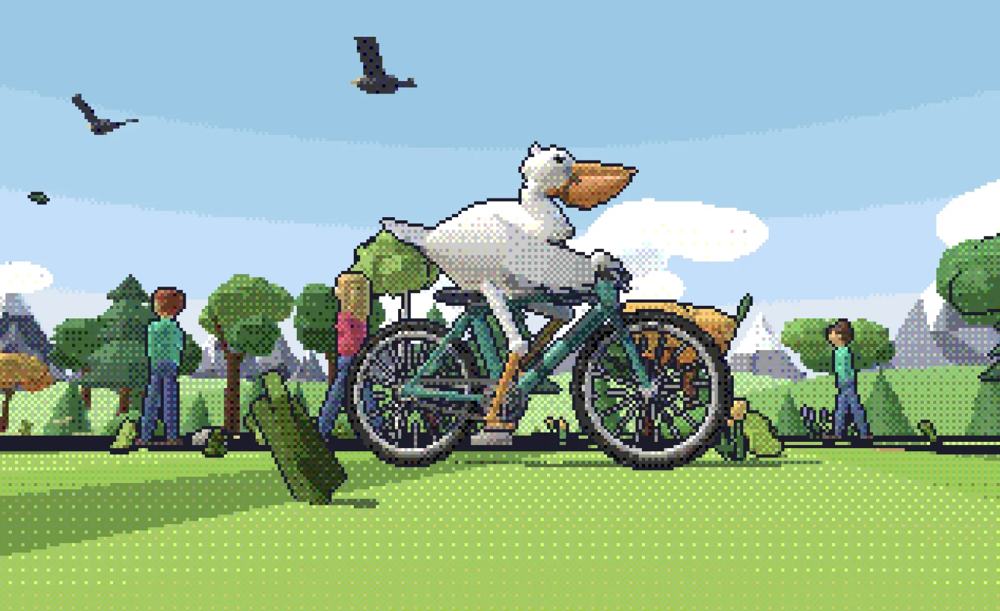

# Pelican on a Bicycle

**[Live demo →](https://pmndre.github.io/deepseek_pelican/)** (needs a browser with WebGPU)

[](https://pmndre.github.io/deepseek_pelican/)

A pelican rides a bicycle through an endless low-poly countryside, rendered in real time with **WebGPU** and an optional pixel-art look.

Everything is procedural: no models, no textures, no libraries besides the dev server. The bike, the rider, the trees, the mountains and the people walking by are all built from code.

## How it was made

This project was made by an agent swarm running **DeepSeek 4.1 Flash** in [pine](https://github.com/pmndre/pine), started with `/swarm`: a lead agent took the job and broke it into tasks on a board, sub-agents worked through them, and the result was checked before it was done.

```bash
npm install
npm run dev
```

## Project layout

| File | What it does |
| --- | --- |
| `src/main.js` | Entry point: canvas sizing, orbit camera, input, frame loop |
| `src/renderer.js` | WebGPU renderer: shadow pass, low-res art pass, upscale and outline pass |
| `src/shaders.js` | WGSL shaders: sky, shadows, lighting, posterise and dither, outline |
| `src/pelican.js` | The pelican and the bicycle, with pedalling, steering and lean |
| `src/world.js` | Ground, grass, flowers, trees, hills, mountains, clouds and the sun |
| `src/actors.js` | People, cats, sheep, birds, airplanes and leaves |
| `src/geometry.js` | Mesh primitives: box, sphere, cylinder, cone, torus, merge |
| `src/math.js` | Matrix and vector helpers |
